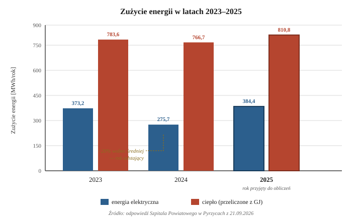
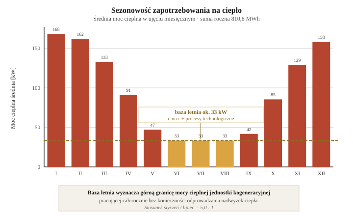
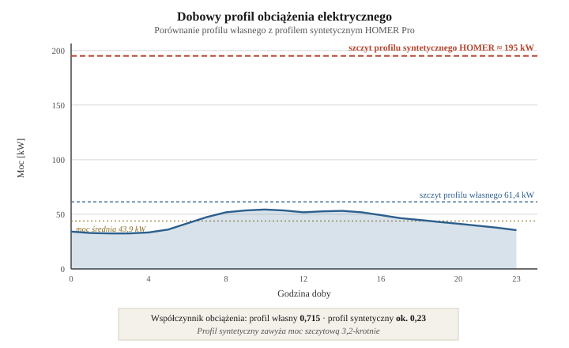
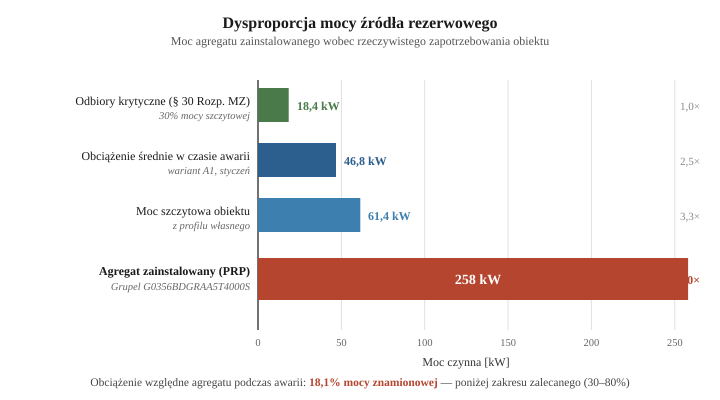
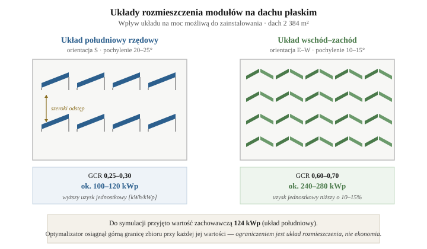

# 4. Założenia projektowe

Rozdział obejmuje charakterystykę obiektu przyjętego za przedmiot analizy oraz
opracowanie danych wejściowych do modelu symulacyjnego. Przyjęto zasadę, zgodnie z którą
wszystkie wielkości wejściowe pochodzą ze źródeł pierwotnych — dokumentacji obiektu,
odpowiedzi jego służb technicznych oraz pomiarów wykonanych na materiale kartograficznym.
Wskaźniki literaturowe zastosowano wyłącznie tam, gdzie dane pierwotne pozostają
niedostępne, każdorazowo zaznaczając ten fakt.

---

## 4.1. Analiza lokalizacji i profil medyczny wybranego obiektu

### 4.1.1. Kryteria doboru obiektu referencyjnego

Dobór obiektu podporządkowano wymaganiom metodyki przyjętej w rozdziale 2. Sformułowano
pięć kryteriów, z których cztery mają charakter rozstrzygający.

| Kryterium | Wymaganie | Uzasadnienie |
|---|---|---|
| **Zabudowa jednobryłowa** | budynek zwarty, bez rozproszenia pawilonowego | warunek jednego węzła przyłączeniowego i jednej szyny cieplnej |
| **Dach płaski** | powierzchnia **nie mniejsza niż 1 000 m²**, bez lądowiska | warunek swobody rozmieszczenia modułów fotowoltaicznych |
| **Skala** | 60–150 łóżek, zużycie rzędu 0,3–1,0 GWh/rok | zakres typowy dla szpitala powiatowego |
| **Dostępność danych** | dane rzeczywiste możliwe do pozyskania | warunek oparcia pracy na wartościach pomiarowych |
| Lokalizacja | województwo zachodniopomorskie | spójność z zasobem słonecznym wyznaczonym w podrozdziale 4.4.4 |

Kryterium zabudowy jednobryłowej wynika z przyjętego zakresu pracy. Szpital pawilonowy
wymagałby odwzorowania rozdziału energii pomiędzy budynkami, co prowadziłoby do analizy
sieci wewnętrznej — zagadnienia wykraczającego poza przedmiot niniejszego opracowania.

Kryterium dostępności danych okazało się w praktyce najtrudniejsze do spełnienia.
Przeprowadzona kwerenda ogólnopolska wykazała, że roczne zużycie energii przez obiekty
szpitalne nie jest publikowane w sposób systematyczny; informacja ta pojawia się
natomiast w **dokumentacji postępowań przetargowych na dostawę energii elektrycznej**,
gdzie stanowi podstawę wyceny oferty. Źródło to uznano za wiarygodne, ponieważ wielkość
podawana przez zamawiającego ma charakter wiążący.

### 4.1.2. Charakterystyka obiektu

Za obiekt referencyjny przyjęto **Szpital Powiatowy w Pyrzycach**, położony przy placu
Wolności 2 w Pyrzycach (74-200), w powiecie pyrzyckim województwa zachodniopomorskiego.

| Wielkość | Wartość |
|---|---|
| Współrzędne geograficzne | 53°08'49,93"N / 14°53'44,66"E |
| Powierzchnia użytkowa | 7 495 m² |
| Kubatura | 29 840 m³ |
| Powierzchnia dachu | 2 384 m² |
| Układ zabudowy | jednobryłowy, dach płaski |
| Termomodernizacja | wykonana w 2005 r. |

Obiekt spełnia wszystkie przyjęte kryteria doboru. Powierzchnia dachu przewyższa
przyjęte minimum 1 000 m² ponad dwukrotnie, co uznano za okoliczność sprzyjającą —
zwiększa swobodę rozmieszczenia modułów i nie stanowi ograniczenia metodycznego.
Liczba łóżek `[DO UZUPEŁNIENIA: dane z rejestru podmiotów wykonujących działalność
leczniczą]`; zużycie energii elektrycznej 384,44 MWh/rok mieści się w zakładanym
przedziale 0,3–1,0 GWh.

**Zaopatrzenie w ciepło stanowi cechę wyróżniającą obiektu.** Szpital zasilany jest
ciepłem z **miejskiej sieci ciepłowniczej opartej na źródle geotermalnym**. Okoliczność
ta ma znaczenie dla oceny układu kogeneracyjnego, omówione w podrozdziale 4.5.

**Zasilanie rezerwowe** realizowane jest przez dwa agregaty prądotwórcze o mocach
znacząco zróżnicowanych:

| Agregat | Moc pozorna STP/PRP | Moc czynna STP/PRP | Zbiornik **nominalny** | Zbiornik **użyteczny** |
|---|---|---|---|---|
| **Grupel G0356BDGRAA5T4000S** | 356 / 323 kVA | 285 / **258 kW** | 1 000 l | **900 l** |
| ZPW 100 DTDEO | 85 kVA | ≈ 68 kW | 120 l | **108 l**¹ |
| **Razem** | — | — | 1 120 l | **1 008 l** |

¹ Ograniczenie napełnienia do 90% odczytano z tabliczki jednostki Grupel. Dla jednostki
ZPW tabliczki nie udokumentowano — przyjęto ten sam współczynnik jako wartość typową.

Jednostka podstawowa, wyprodukowana w czerwcu 2023 r., opatrzona jest oznaczeniem
ograniczającym stopień napełnienia zbiornika do **90% pojemności nominalnej**. Pojemność
użyteczna wynosi zatem **900 litrów** — wielkość rozstrzygającą dla analizy
przeprowadzonej w rozdziale 7.

**Stan dokumentacji technicznej.** Dokumentacja termomodernizacji zachowała się
w ilościach szczątkowych; **audyt energetyczny obiektu nie istnieje** i znajduje się
obecnie w trakcie opracowania. Okoliczność ta determinuje sposób pozyskania danych
o zapotrzebowaniu na ciepło, opisany w podrozdziale 4.2.3.

### 4.1.3. Pozyskanie danych rzeczywistych

Dane obiektu pozyskano trzema niezależnymi drogami, co umożliwiło ich wzajemną
weryfikację.

**Droga pierwsza — dokumentacja przetargowa.** Z postępowania na dostawę energii
elektrycznej odczytano wielkość zużycia rocznego. Odczytana wartość — ok. 355 MWh/rok — posłużyła jako podstawa wstępnej budowy
profilu obciążenia i odbiega o 7,6% od wielkości podanej następnie przez obiekt
dla roku 2025 (384,44 MWh).

**Droga druga — wniosek o udostępnienie informacji publicznej.** Do Działu
Gospodarczo-Technicznego szpitala skierowano wniosek w trybie ustawy z dnia 6 września
2001 r. o dostępie do informacji publicznej. Odpowiedź otrzymano **21 września 2026 r.**
Przekazano w niej dane o zużyciu energii elektrycznej i ciepła za lata 2023–2025,
parametry agregatów, geometrię budynku oraz informację o źródle ciepła.

**Droga trzecia — dokumentacja własna.** Wykonano fotografię tabliczki znamionowej
agregatu podstawowego oraz pomiar powierzchni dachu na państwowej ortofotomapie
(Geoportal). Pomiar kartograficzny dał wynik 2 110 m², zaniżony o 11,5% wobec wartości
podanej przez obiekt — rozbieżność tłumaczy się zacienieniem krawędzi dachu
na zobrazowaniu lotniczym. Do dalszych obliczeń przyjęto wartość podaną przez obiekt.

---

## 4.2. Profil zapotrzebowania na energię elektryczną i cieplną

### 4.2.1. Metodyka opracowania profilu godzinowego

Narzędzie symulacyjne HOMER Pro wymaga danych wejściowych w postaci szeregu czasowego
o rozdzielczości godzinowej, obejmującego **8 760 wartości** — po jednej na każdą godzinę
roku. Szpital nie dysponuje natomiast danymi pomiarowymi o takiej rozdzielczości;
przekazane wielkości mają charakter sum rocznych.

Zastosowano zatem **metodę kalibracji kształtu profilu na sumie rocznej**, obejmującą
cztery kroki:

1. przyjęcie kształtu dobowego właściwego dla obiektu szpitalnego — na podstawie
   charakterystyk publikowanych w literaturze przedmiotu `[ŹRÓDŁO]`,
2. nałożenie zmienności sezonowej — dla profilu elektrycznego współczynników
   miesięcznych, dla cieplnego metody stopniodni,
3. wprowadzenie rozróżnienia dni roboczych i wolnych oraz składowej losowej
   odwzorowującej zmienność dobową,
4. przeskalowanie całości tak, aby suma 8 760 wartości odpowiadała **dokładnie**
   zużyciu rocznemu podanemu przez obiekt.

Krok czwarty gwarantuje zgodność bilansu energetycznego z danymi rzeczywistymi.
Kształt profilu pozostaje przybliżeniem, natomiast jego całka jest wielkością pomiarową.

> **Ograniczenie metody.** Profil odwzorowuje prawidłowo bilans energii oraz przebieg
> dobowy i sezonowy, nie odwzorowuje natomiast krótkotrwałych szczytów mocy
> pochodzących od pojedynczych odbiorników (tomografia komputerowa, sterylizatornia).
> Ograniczenie to nie wpływa na wynik testu przetrwania, opartego na bilansie energii
> w okresie wielogodzinnym, wpływa natomiast na dobór mocy przyłączeniowej.
> Zastąpienie profilu odczytami 15-minutowymi z układu pomiarowego operatora stanowi
> zadanie wskazane do dalszych prac.

### 4.2.2. Profil zapotrzebowania na energię elektryczną

Szpital rozliczany jest w taryfie **B22**. Zużycie energii elektrycznej w latach
2023–2025 kształtowało się następująco:

| Rok | Zużycie [MWh] | Odchylenie od średniej |
|---|---|---|
| 2023 | 373,24 | +8,4% |
| 2024 | 275,68 | −20,0% |
| **2025** | **384,44** | **+11,6%** |
| Średnia trzyletnia | 344,45 | — |



*Rys. 4.1. Zużycie energii elektrycznej i ciepła w latach 2023–2025.*

Rok 2024 odbiega od pozostałych o blisko 100 MWh, tj. o jedną czwartą. Rozbieżność
tej skali nie daje się wytłumaczyć zmiennością pogodową ani eksploatacyjną; wskazuje
na okoliczność jednorazową — ograniczenie działalności oddziału, remont lub zmianę
sposobu rozliczania. Do dalszych obliczeń przyjęto zatem **rok 2025** jako ostatni
pełny i jednocześnie reprezentatywny, odrzucając uśrednianie z rokiem odstającym.

Opracowany profil godzinowy charakteryzuje się następującymi wielkościami:

| Wielkość | Wartość |
|---|---|
| Zużycie roczne | **384,44 MWh** |
| Zużycie dobowe średnie | 1 053,3 kWh/d |
| Moc średnia | **43,89 kW** |
| Moc szczytowa | **61,42 kW** |
| **Współczynnik obciążenia** | **0,715** |
| Miesiąc szczytowy | sierpień |

Współczynnik obciążenia na poziomie 0,715 jest następstwem przyjętego kształtu
profilu, a zatem nie stanowi niezależnego potwierdzenia charakteru obiektu.
Odpowiada on natomiast wartościom podawanym dla obiektów szpitalnych `[ŹRÓDŁO]`,
co uznano za przesłankę poprawności przyjętego kształtu: szpital stanowi odbiorcę o wysokiej równomierności poboru, pracujący
w trybie ciągłym. Dla porównania, obiekty biurowe osiągają wartości rzędu 0,3–0,4.
Wysoki współczynnik obciążenia **elektrycznego** jest okolicznością sprzyjającą dla
układów kogeneracyjnych, wymagających stabilnej bazy obciążenia. Jak wykazano
w rozdziale 7, o czasie pracy jednostki decyduje jednak baza **cieplna**, podlegająca
silnej zmienności sezonowej — stąd mimo korzystnego profilu elektrycznego czas pracy
jednostki kogeneracyjnej pozostaje niski.

**Rozbieżność wobec mocy umownej.** W odpowiedzi szpitala podano moc umowną na poziomie
422 kW. Przy rocznym zużyciu 384,44 MWh odpowiada to współczynnikowi wykorzystania mocy
umownej równemu **10,4%** — wartości nietypowo niskiej. Rozbieżność wobec mocy szczytowej
wyznaczonej z profilu (61,42 kW) wynosi blisko siedmiokrotność. Możliwe przyczyny
obejmują ustalenie mocy umownej z zapasem historycznym, występowanie krótkotrwałych
szczytów nieujętych w profilu oraz błąd redakcyjny odpowiedzi. Kwestia pozostaje
nierozstrzygnięta i wymaga weryfikacji na podstawie faktur; nie wpływa natomiast
na bilans energetyczny będący przedmiotem analizy.

### 4.2.3. Profil zapotrzebowania na ciepło

Zapotrzebowanie na ciepło pozyskano z rozliczeń z dostawcą ciepła sieciowego:

| Rok | Zużycie [GJ] | Przeliczenie [MWh] |
|---|---|---|
| 2023 | 2 821 | 783,6 |
| 2024 | 2 760 | 766,7 |
| **2025** | **2 919** | **810,8** |
| Średnia | 2 833 | 787,0 |

W odróżnieniu od zużycia energii elektrycznej, zapotrzebowanie na ciepło wykazuje
**wysoką stabilność** — rozrzut trzyletni nie przekracza 6%. Potwierdza to, że
odstępstwo roku 2024 w bilansie elektrycznym miało charakter lokalny i nie dotyczyło
funkcjonowania obiektu jako całości.

Profil godzinowy opracowano metodą stopniodni grzania przy temperaturze bazowej 15 °C,
z podziałem zapotrzebowania na trzy składowe:

| Składowa | Udział | Charakterystyka |
|---|---|---|
| Centralne ogrzewanie | 64% | sezonowa, wg stopniodni |
| Ciepła woda użytkowa | 25% | całoroczna, zmienność dobowa |
| Procesy technologiczne | 11% | całoroczna, stała (sterylizacja, pralnia) |

Uzyskano następujące wielkości:

| Wielkość | Wartość |
|---|---|
| Zapotrzebowanie roczne | **810,8 MWh** |
| Moc cieplna średnia | 92,56 kW |
| Moc cieplna szczytowa | **242,0 kW** |
| **Baza letnia (VI–VIII)** | **ok. 33 kW** |



*Rys. 4.2. Średnia moc cieplna w ujęciu miesięcznym z zaznaczeniem bazy letniej.*

**Baza letnia stanowi wielkość rozstrzygającą dla doboru jednostki kogeneracyjnej.**
Układ skojarzony pracuje efektywnie wyłącznie przy odbiorze ciepła; w miesiącach letnich
zapotrzebowanie ogranicza się do ciepłej wody użytkowej i procesów technologicznych.
Wartość ok. 33 kW wyznacza górną granicę mocy cieplnej jednostki pracującej całorocznie
bez konieczności odprowadzania nadwyżek ciepła.

> **Uwaga.** Wielkość 810,8 MWh pochodzi z rozliczeń z dostawcą ciepła i ma charakter
> pomiarowy. Podział na trzy składowe oraz kształt profilu dobowego opierają się
> natomiast na wskaźnikach literaturowych, ponieważ obiekt nie dysponuje opomiarowaniem
> rozdzielnym. Weryfikacja nastąpi po zakończeniu audytu energetycznego.

### 4.2.4. Weryfikacja względem profilu syntetycznego

W celu oceny poprawności opracowanego profilu przeprowadzono porównanie z profilem
syntetycznym generowanym przez HOMER Pro dla obiektu typu *Community — Hospital*
przy zadanej tej samej sumie rocznej.

| Wielkość | Profil własny | Profil syntetyczny HOMER | Różnica |
|---|---|---|---|
| Zużycie roczne | 384,44 MWh | 384,44 MWh | — |
| Moc średnia | 43,89 kW | 43,89 kW | — |
| **Moc szczytowa** | **61,42 kW** | **ok. 195 kW** | **3,2×** |
| Współczynnik obciążenia | 0,715 | ok. 0,23 | 3,1× |



*Rys. 4.3. Dobowy profil obciążenia elektrycznego — porównanie profilu własnego
z profilem syntetycznym HOMER Pro.*

Profil syntetyczny **zawyża moc szczytową ponad trzykrotnie**, odwzorowując
charakterystykę obiektu o wyraźnych szczytach dobowych. Zastosowanie go prowadziłoby
do przewymiarowania wszystkich źródeł sterowalnych oraz do zawyżenia wyznaczonego
zapotrzebowania na paliwo w analizie awaryjnej.

Ustalenie to **uzasadnia opracowanie profilu własnego** i stanowi wynik metodyczny
o znaczeniu wykraczającym poza niniejszą pracę: profile wbudowane w narzędzia
optymalizacyjne nie odwzorowują poprawnie charakterystyki obiektów szpitalnych
o wysokim współczynniku obciążenia.

---

## 4.3. Identyfikacja obciążeń krytycznych

Podział odbiorów przeprowadzono zgodnie z normą **PN-HD 60364-7-710** oraz z § 42
Rozporządzenia Ministra Zdrowia, określającym minimalną moc źródła rezerwowego.

Norma posługuje się **dwiema niezależnymi klasyfikacjami**, omówionymi
w podrozdziale 3.1, których nie należy utożsamiać:

- **grupy pomieszczeń** (0, 1, 2) — według skutku zaniku napięcia dla pacjenta,
- **klasy przerwy w zasilaniu** (≤ 0,5 s, ≤ 15 s, > 15 s) — według dopuszczalnego
  czasu restytucji.

| Grupa pomieszczeń | Przykładowe pomieszczenia | Wymagana klasa przerwy | Źródło zasilania |
|---|---|---|---|
| **2** | bloki operacyjne, OIOM, kardiochirurgia | **≤ 0,5 s** | UPS → agregat |
| **1** | sale zabiegowe, diagnostyka, oddziały łóżkowe | **≤ 15 s** | agregat |
| **0** | pomieszczenia bez aparatury medycznej | > 15 s | sieć / agregat |
| poza klasyfikacją | administracja, kuchnia, pralnia, klimatyzacja komfortu | — | sieć |

Odbiorami krytycznymi w rozumieniu niniejszej pracy są odbiory pomieszczeń
**grup 1 i 2**, tj. wymagające przerwy nie dłuższej niż 15 s. Odbiory grupy 2
wymagają dodatkowo zasilacza UPS, ponieważ czas rozruchu agregatu
(do 15 s) przekracza dopuszczalną dla nich przerwę 0,5 s.

Wymóg § 42 określa moc źródła rezerwowego na poziomie **nie mniejszym niż 30% mocy
szczytowej obiektu**. Dla rozpatrywanego obiektu daje to:

```
P_kryt = 0,30 × 61,42 kW = 18,4 kW
```

Wielkość ta wyznacza **dolną granicę zapotrzebowania w trybie awaryjnym**, przy założeniu
odłączenia odbiorów nieistotnych. Zestawienie jej z mocą faktycznie zainstalowaną ujawnia
zasadniczą dysproporcję:

| Wielkość | Wartość | Krotność P_kryt |
|---|---|---|
| Odbiory krytyczne (§ 42) | 18,4 kW | 1,0 |
| Obciążenie średnie w czasie awarii (A1) | 46,8 kW | 2,5 |
| **Agregat zainstalowany (PRP)** | **258 kW** | **14,0** |



*Rys. 4.4. Moc agregatu zainstalowanego wobec rzeczywistego zapotrzebowania obiektu.*

Agregat zainstalowany przewyższa wymóg ustawowy czternastokrotnie, moc szczytową
obiektu — ponad czterokrotnie, a obciążenie średnie w czasie awarii — pięciokrotnie. Konsekwencje tej dysproporcji dla zużycia paliwa omówiono
w rozdziale 7.

Ustalenie, które konkretnie obwody zasilane są z poszczególnych agregatów, wymaga dostępu
do schematu rozdzielni obiektu. Wystąpiono o tę informację pismem uzupełniającym;
do czasu jej otrzymania analizę prowadzi się przy założeniu zasilania **całości obiektu**,
co stanowi podejście zachowawcze.

---

## 4.4. Analiza przestrzenna dachu i wyznaczenie granicznej mocy PV

### 4.4.1. Charakterystyka powierzchni

Dach obiektu jest **płaski, o powierzchni 2 384 m²**, pozbawiony lądowiska dla śmigłowców.
Oględziny ortofotomapy nie wykazały obiektów zacieniających w bezpośrednim sąsiedztwie
budynku. Powierzchnia dostępna pod zabudowę jest zatem ograniczona wyłącznie
infrastrukturą własną dachu — wyrzutniami wentylacyjnymi, wyłazami, kominami oraz
strefami komunikacji serwisowej.

Przyjęto **współczynnik wykorzystania powierzchni równy 0,80**, co odpowiada wartości
typowej dla dachów obiektów użyteczności publicznej:

```
A_dostępna = 2 384 m² × 0,80 = ok. 1 900 m²
```

### 4.4.2. Wyznaczenie mocy granicznej

Moc możliwa do zainstalowania zależy od przyjętego układu rozmieszczenia modułów.
Dla dachu płaskiego rozważa się dwa rozwiązania, różniące się współczynnikiem pokrycia
powierzchni (*Ground Coverage Ratio*, GCR).

Przyjęto moduł o mocy 450 Wp i wymiarach 1 134 × 1 722 mm, tj. powierzchni 1,953 m²,
co odpowiada **4,34 m² powierzchni modułów na 1 kWp**. Moc możliwą do zainstalowania
wyznaczono zależnością:

```
P = A_dostępna · GCR / 4,34        [kWp]
```

| Układ | Orientacja | Pochylenie | GCR | Moc | Liczba modułów |
|---|---|---|---|---|---|
| **Południowy rzędowy** | S | 20–25° | **0,28** | **123 kWp** | 273 |
| Wschód–zachód | E–W | 10–15° | 0,65 | 286 kWp | 634 |

Dla układu południowego: 1 907 · 0,28 / 4,34 = **123 kWp**. Wartość zaokrąglono
w górę do **124 kWp** ze względu na krok zbioru poszukiwań przyjęty w rozdziale 5.



*Rys. 4.5. Porównanie układu południowego rzędowego z układem wschód–zachód.*

Układ południowy zapewnia **wyższy uzysk jednostkowy** (kWh/kWp), wymaga natomiast
szerokich odstępów między rzędami, zapobiegających wzajemnemu zacienianiu w okresie
zimowego przesilenia. Układ wschód–zachód obniża uzysk jednostkowy o ok. 10–15%,
pozwala jednak na ponaddwukrotnie gęstsze upakowanie modułów, a tym samym na wyższą
produkcję z jednostki powierzchni dachu.

Do symulacji przyjęto **124 kWp**, odpowiadające układowi południowemu. Wartość tę
określa się w dalszej części pracy jako zachowawczą — nie dlatego, że leży poniżej
wyniku obliczenia, lecz dlatego, że odpowiada układowi o niższym stopniu wykorzystania
powierzchni spośród dwóch rozpatrywanych. Wybór uzasadniono brakiem rozstrzygnięcia
co do układu rozmieszczenia na etapie modelowania architektury systemu.

> **Zastrzeżenie.** Przyjęty współczynnik pokrycia (GCR 0,28) oraz współczynnik
> wykorzystania powierzchni dachu (0,80) są `[ŹRÓDŁO]` wartościami typowymi, nie zaś
> wynikiem rozmieszczenia modułów na rzeczywistym obrysie dachu z uwzględnieniem
> przeszkód. Weryfikacja wymaga opracowania rozmieszczenia w oprogramowaniu
> specjalistycznym (rozdział 6).

### 4.4.3. Wniosek z symulacji — ograniczenie powierzchniowe

Przeprowadzone obliczenia optymalizacyjne (rozdział 7) wykazały, że **optymalizator
osiąga górną granicę przyjętego zbioru poszukiwań przy każdej jej wartości**.
Zbiór rozszerzano trzykrotnie — do 110, 124 oraz, w próbie kontrolnej, 150 kWp —
i za każdym razem wybierana była wartość najwyższa, przy komunikacie
`PV search space may be insufficient`. Wynik próby kontrolnej dla 150 kWp
(NPC 1,76 M$, LCOE 0,180, zwrot 6,3 lat) nie został włączony do zestawień
w rozdziale 7, ponieważ wartość ta przekracza moc możliwą do zainstalowania
w układzie południowym.

Oznacza to, że **moc uzasadniona ekonomicznie przewyższa przyjętą granicę powierzchniową**.
Ograniczeniem instalacji nie jest zatem opłacalność, lecz dostępna powierzchnia dachu —
a ściślej: przyjęty układ rozmieszczenia modułów.

Ustalenie to ma konsekwencję projektową: **rozważenie układu wschód–zachód jest
uzasadnione**, ponieważ pozwoliłoby na zbliżenie się do optimum ekonomicznego
wyznaczonego przez optymalizator. Weryfikacja wymaga opracowania rozmieszczenia
w oprogramowaniu specjalistycznym, uwzględniającego rzeczywiste położenie przeszkód
dachowych oraz nośność konstrukcji. Zagadnienie to podjęto w rozdziale 6.

### 4.4.4. Zasób słoneczny

Dane o nasłonecznieniu pobrano z bazy **NASA POWER** dla współrzędnych obiektu,
obejmujących okres 42 lat obserwacji.

| Wielkość | Wartość |
|---|---|
| Napromieniowanie całkowite średnioroczne (GHI) | **2,72 kWh/m²/d** |
| Napromieniowanie w styczniu | 0,73 kWh/m²/d |
| Napromieniowanie w maju | 4,85 kWh/m²/d |
| Stosunek maj / styczeń | **6,6 : 1** |

Sezonowość zasobu słonecznego w warunkach polskich wyklucza oparcie zasilania awaryjnego
na instalacji fotowoltaicznej. W styczniu — miesiącu przyjętym do modelowania zdarzenia
*black-sky* — napromieniowanie stanowi **15% wartości majowej**. Konsekwencje tego faktu
dla bilansu awaryjnego omówiono w rozdziale 7.

---

## 4.5. Zestawienie przyjętych założeń

### 4.5.1. Dane wejściowe modelu

| Parametr | Wartość | Źródło |
|---|---|---|
| Zużycie energii elektrycznej | 384,44 MWh/rok | odpowiedź szpitala (2025) |
| Moc średnia / szczytowa | 43,89 / 61,42 kW | profil własny |
| Współczynnik obciążenia | 0,715 | profil własny |
| Zapotrzebowanie na ciepło | 810,8 MWh/rok | odpowiedź szpitala (2025) |
| Moc cieplna średnia / szczytowa | 92,56 / 242,0 kW | profil własny |
| Baza cieplna letnia | ok. 33 kW | profil własny |
| Odbiory krytyczne (§ 42) | 18,4 kW | przeliczenie |
| Powierzchnia dachu | 2 384 m² | odpowiedź szpitala |
| Graniczna moc PV (układ S) | 124 kWp | przeliczenie |
| Zasób słoneczny (GHI) | 2,72 kWh/m²/d | NASA POWER |
| Agregat — moc PRP | 258 kW | tabliczka znamionowa |
| **Zbiornik paliwa — pojemność użyteczna** | **900 l** | przeliczenie (1 000 l × 90%) |
| Źródło ciepła | sieć geotermalna | odpowiedź szpitala |

### 4.5.2. Założenie dotyczące zaopatrzenia w ciepło podczas awarii

Zasilanie obiektu ciepłem z sieci geotermalnej wymaga odrębnego rozstrzygnięcia
na potrzeby modelowania zdarzeń awaryjnych. Ciepłownia geotermalna wykorzystuje pompy
obiegowe oraz pompy głębinowe, zasilane energią elektryczną z tej samej sieci
dystrybucyjnej co obiekt szpitalny.

W braku potwierdzenia, czy ciepłownia dysponuje własnym zasilaniem rezerwowym, przyjęto
**założenie zachowawcze**:

> Podczas zdarzenia o charakterze systemowym dostawa ciepła z sieci geotermalnej ustaje.

Założenie to przyjęto jako niekorzystne, a zatem bezpieczne z punktu widzenia oceny
bezpieczeństwa energetycznego obiektu. Pociąga ono dwie konsekwencje:

1. szpital traci podczas zdarzenia *black-sky* nie tylko zasilanie elektryczne, lecz
   również dostawę ciepła — w warunkach stycznia stanowi to zagrożenie samoistne,
   niezależne od bilansu elektrycznego,
2. **odzysk ciepła z jednostki kogeneracyjnej przestaje być efektem ubocznym, a staje się
   funkcją podstawową** — jest to jedyne w rozpatrywanych konfiguracjach źródło ciepła
   niezależne od sieci elektroenergetycznej.

### 4.5.3. Ocena środowiskowa kogeneracji w kontekście źródła geotermalnego

Zasilanie obiektu ciepłem geotermalnym zmienia ocenę układu kogeneracyjnego względem
sytuacji typowej. W obiekcie wyposażonym w kocioł gazowy jednostka CHP zastępuje źródło
kopalne, osiągając korzyść środowiskową wynikającą ze sprawności skojarzonej. W obiekcie
rozpatrywanym jednostka CHP **konkurowałaby ze źródłem odnawialnym**, co unieważnia
argument środowiskowy w zakresie zaopatrzenia podstawowego.

Uzasadnienie dla kogeneracji ogranicza się zatem do **funkcji rezerwowej** — zdolności
do zasilania obiektu w energię elektryczną i ciepło w warunkach utraty obu mediów
sieciowych. Ocena ta znajduje potwierdzenie w wynikach symulacji, omówionych
w rozdziale 7.

---

## 4.6. Ograniczenia przyjętych założeń

Rzetelność pracy wymaga wskazania wielkości, które pozostają oszacowaniami.

| Wielkość | Charakter | Wpływ na wynik | Sposób weryfikacji |
|---|---|---|---|
| Kształt profilu godzinowego | oszacowanie | brak wpływu na bilans; wpływ na dobór mocy | odczyty 15-min z układu pomiarowego OSD |
| Podział zapotrzebowania na ciepło | oszacowanie | wpływ na dobór mocy cieplnej CHP | audyt energetyczny w opracowaniu |
| Charakterystyka zużycia paliwa agregatu | oszacowanie | **rozstrzygający dla czasu autonomii** | DTR producenta (wystąpiono) |
| Współczynnik wykorzystania dachu (0,80) | założenie | wpływ na graniczną moc PV | rozmieszczenie w oprogramowaniu CAD |
| Zasilanie rezerwowe ciepłowni | założenie zachowawcze | wpływ na ocenę K3 | zapytanie do operatora sieci |
| Moc umowna 422 kW | rozbieżność nierozstrzygnięta | **wpływ na P_kryt oraz na wnioski podrozdziałów 7.2.4 i 8.1** | faktury za energię |
| **Źródło ciepła w modelu** | **niezgodne ze stanem faktycznym** | **zawyża ocenę Konfiguracji K3** | przebudowa modelu |

Charakterystyka zużycia paliwa, oznaczona jako rozstrzygająca, poddana została
**analizie wrażliwości** obejmującej trzy krzywe (rozdział 7). Dwie pozycje wymagają
odrębnego omówienia, ponieważ **ograniczają zakres obowiązywania wniosków**.

### 4.6.1. Modelowanie źródła ciepła — niezgodność ze stanem faktycznym

W modelu symulacyjnym zaopatrzenie obiektu w ciepło odwzorowano kotłem gazowym
(`Generic Boiler`, sprawność 85%, cena gazu 0,65 $/m³), obecnym we wszystkich
konfiguracjach. Obiekt zasilany jest natomiast **ciepłem z sieci geotermalnej**,
co ustalono dopiero po zbudowaniu modelu.

Niezgodność ta pociąga dwie konsekwencje:

1. **Koszt bieżący netto wszystkich konfiguracji zawiera wydatek na gaz dla kotła,
   którego obiekt nie ponosi.** Wielkość odniesienia (1,91 mln $) obejmuje zatem
   pozycję nieistniejącą w rzeczywistych kosztach szpitala.
2. **Konfiguracja K3 otrzymuje w modelu korzyść za wyparcie tego kotła** przez odzysk
   ciepła z jednostki kogeneracyjnej. W rzeczywistości kogeneracja wypierałaby ciepło
   geotermalne, nie zaś ciepło z kotła gazowego.

### Kierunek zniekształcenia

Koszt jednostkowy ciepła z kotła przyjętego w modelu wynosi:

```
0,65 $/m³ / (9,97 kWh/m³ · 0,85) = 0,0767 $/kWh ≈ 85 PLN/GJ
```

Wartość ta mieści się w przedziale przyjętym dla ciepła sieciowego (60–90 PLN/GJ,
załącznik C), wobec czego **kierunku zniekształcenia nie można określić jednoznacznie**:

| Rzeczywista cena ciepła sieciowego | Skutek dla oceny Konfiguracji K3 |
|---|---|
| **poniżej 85 PLN/GJ** | model **zawyża** korzyść z odzysku ciepła — K3 oceniona zbyt korzystnie |
| **ok. 85 PLN/GJ** | zniekształcenie pomijalne |
| **powyżej 85 PLN/GJ** | model **zaniża** korzyść — K3 oceniona zbyt surowo |

Rozstrzygnięcie wymaga taryfy za ciepło sieciowe — `[DO UZUPEŁNIENIA: taryfa dostawcy
ciepła]`. Do czasu jej uzyskania wnioski dotyczące ekonomiki Konfiguracji K3
(podrozdział 7.5.2) należy traktować jako **obarczone niepewnością o nieustalonym
znaku**, o wielkości rzędu kosztu ciepła dla 810,8 MWh rocznie.

**Niezależnie od ceny** pozostaje natomiast ustalone, że kogeneracja gazowa
w tym obiekcie **nie zastępuje źródła kopalnego**, lecz odnawialne — co unieważnia
argument środowiskowy, niezależnie od rachunku ekonomicznego (podrozdział 7.4.1).

Przeliczenie modelu z zakupem ciepła sieciowego w miejsce kotła wymagałoby ponownych
symulacji, niemożliwych po wygaśnięciu licencji narzędzia.

### 4.6.2. Moc szczytowa — wielkość wyznaczona, nie zmierzona

Moc szczytowa 61,42 kW pochodzi z profilu opracowanego metodą opisaną w podrozdziale
4.2.1, który — jak tam zaznaczono — nie odwzorowuje krótkotrwałych szczytów
pochodzących od pojedynczych odbiorników. Moc umowna obiektu jest od niej
**6,9-krotnie wyższa**.

Od wartości tej zależą bezpośrednio:

- moc odbiorów krytycznych (30% mocy szczytowej), a zatem wynik analizy pracy
  wyspowej (podrozdział 7.2.4),
- krotność, o jaką agregat zainstalowany przewyższa wymóg § 42.

Gdyby rzeczywista moc szczytowa była istotnie wyższa od wyznaczonej, moc odbiorów
krytycznych przekroczyłaby obciążenie graniczne wyznaczone w podrozdziale 7.2.4,
a wniosek o skuteczności odciążania przestałby obowiązywać. **Wyniki podrozdziału
7.2.4 należy zatem traktować jako warunkowe** — obowiązujące przy założeniu, że
odbiory krytyczne nie przekraczają 24,6 kW.

Rozstrzygnięcie wymaga odczytów 15-minutowych z układu pomiarowego operatora.

---

## Powiązane

**Źródła danych rozdziału:**

- [[04_Odpowiedz_szpitala_dane_rzeczywiste]] — zużycie energii, geometria, źródło ciepła
- [[05_Agregat_GRUPEL_dane_z_tabliczki]] — parametry agregatu, pojemność zbiornika
- [[02_Charakterystyka_obiektu_Pyrzyce]] — karta obiektu
- [[03_Kwerenda_ogolnopolska_obiekty]] — kwerenda poprzedzająca wybór

**Podstawa teoretyczna (rozdział 3):**

- [[3_1_Szpital_infrastruktura_krytyczna]] — grupy odbiorów, § 42
- [[3_2_Agregaty_Diesel]] — praca niskoobciążeniowa, logistyka paliwa
- [[3_3_Instalacje_PV]] — GCR, ograniczenia dachu płaskiego
- [[3_5_Kogeneracja_CHP]] — baza cieplna, sprawność skojarzona

**Rozdziały następne:** [[04_Wyniki_V2_dane_rzeczywiste]] — wyniki na przyjętych założeniach

**Materiał graficzny:** [[00_INDEKS_RYSUNKOW]]

**Nawigacja:** [[00_Szkielet_Pracy]] · [[00_STAN_PRAC]]
