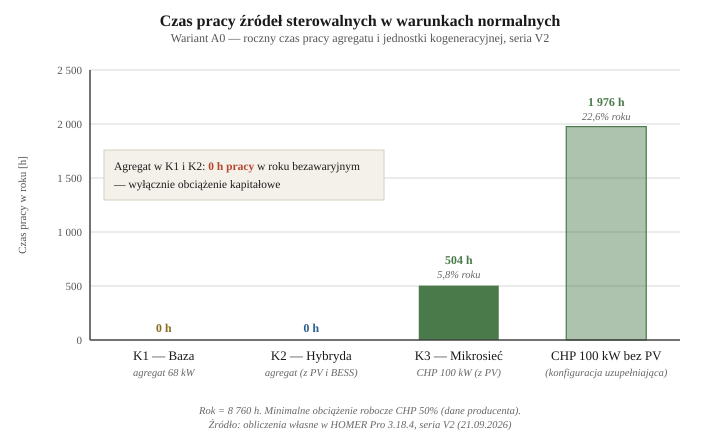
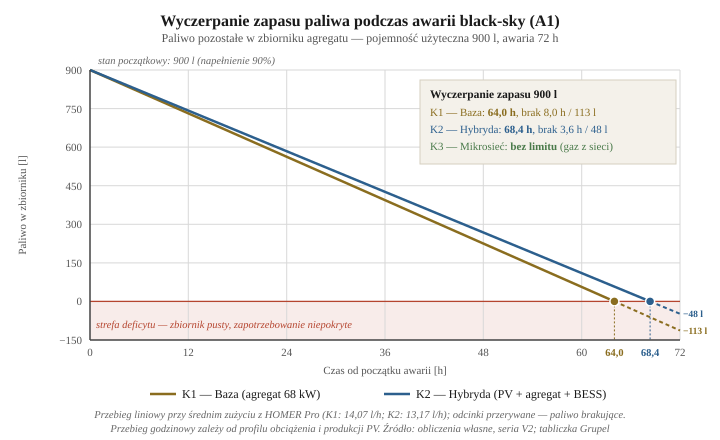
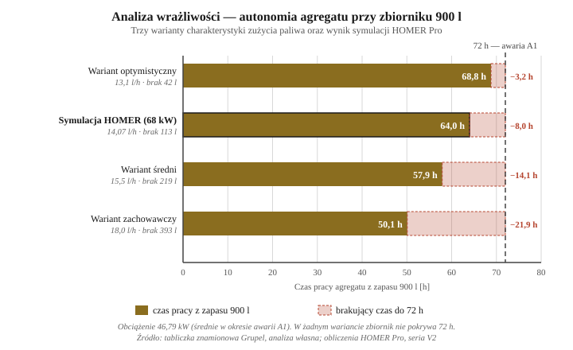
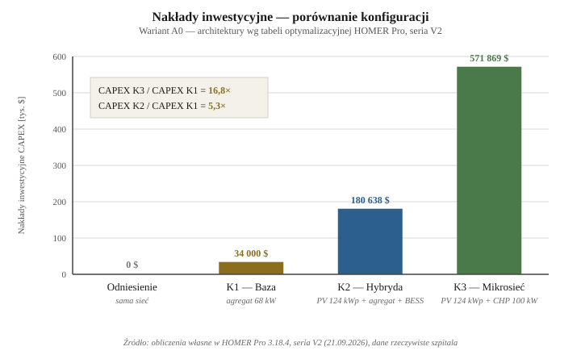
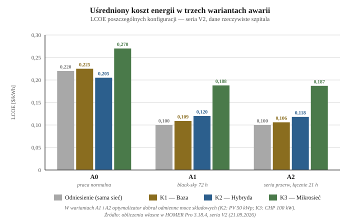
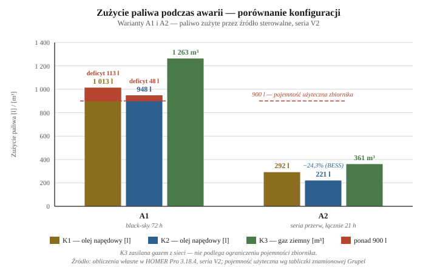

# 7. Analiza wyników symulacji

Rozdział obejmuje omówienie wyników trzech serii obliczeniowych wykonanych
w środowisku HOMER Pro na danych rzeczywistych obiektu. Analizę przeprowadzono
w czterech płaszczyznach: technicznej, odpornościowej, ekonomicznej i środowiskowej,
po czym zestawiono je w ocenie wielokryterialnej.

Przyjęto podział na **konfiguracje** (K1, K2, K3 — architektura systemu) oraz
**warianty stanu sieci** (A0, A1, A2), zgodnie z metodyką
opisaną w rozdziale 5.

---

## 7.1. Analiza techniczna

### 7.1.1. Pokrycie zapotrzebowania i udział źródeł własnych

W wariancie pracy normalnej (A0) wszystkie konfiguracje pokrywają zapotrzebowanie
obiektu w całości (tab. 7.1). Różnicuje je natomiast udział źródeł własnych oraz stopień
wykorzystania zainstalowanych urządzeń.

| Konfiguracja | NPC | LCOE [$/kWh] | CAPEX | Udział OZE | Czas pracy źródła |
|---|---|---|---|---|---|
| *Odniesienie — sama sieć* | 1,91 M$ | 0,220 | 0 $ | 0% | — |
| **K1** — agregat 68 kW | 1,93 M$ | 0,225 | 34 000 $ | 0% | **0 h** |
| **K2** — PV + agregat + BESS | **1,84 M$** | **0,205** | 180 638 $ | 8,50% | **0 h** |
| **K3** — PV + BESS + CHP | 2,24 M$ | 0,285 | 596 638 $ | 8,50% | 476 h |

*Tab. 7.1. Wyniki wariantu A0 — praca normalna*



*Rys. 7.1. Roczny czas pracy źródeł sterowalnych w warunkach normalnych*

**Agregat prądotwórczy nie zostaje uruchomiony ani razu w ciągu roku** (rys. 7.1).
Wynik ten powtarza się w obu konfiguracjach, które go zawierają (K1 i K2), niezależnie od
obecności pozostałych komponentów. Przy nieprzerwanej dostępności sieci agregat
stanowi wyłącznie obciążenie kapitałowe — podnosi koszt bieżący netto
o ok. 20 000 $ (1,934 wobec 1,914 M$) oraz uśredniony koszt energii o 0,005 $/kWh,
nie uczestnicząc w produkcji.

Wynik ten jest wprawdzie oczekiwany — przy nieprzerwanej dostępności sieci agregat
nie ma powodu się uruchamiać — lecz pozwala **wyrazić liczbowo** koszt utrzymywania
rezerwy, opisany jakościowo w podrozdziale 3.2. Wydatek ponoszony jest stale,
korzyść zaś wyłącznie w zdarzeniu, które może nie wystąpić przez wiele lat.

**Jednostka kogeneracyjna pracuje 476 godzin rocznie**, co stanowi 5,4% czasu roku.
W układzie pozbawionym instalacji fotowoltaicznej i magazynu czas ten wzrasta
do 1 976 godzin. Przyczyną niskiego wykorzystania jest przewymiarowanie: najmniejsza
jednostka gazowa dostępna w katalogu HOMER Pro ma moc 100 kW, podczas gdy moc średnia
obiektu wynosi 43,89 kW, a letnia baza cieplna — ok. 33 kW.

**Instalacja fotowoltaiczna wytwarza ok. 114,7 MWh rocznie**, co odpowiada 29,8%
zużycia energii elektrycznej obiektu. Udział odnawialny podawany przez optymalizator
(8,50%) odnosi się do sumy obciążeń elektrycznego i cieplnego, wynoszącej 1 195 MWh.

### 7.1.2. Energia niedostarczona i niedobór mocy

W wariantach awaryjnych dopuszczalny roczny niedobór mocy podniesiono do 10%.
Zabieg ten jest konieczny: przy wartości zerowej optymalizator odrzuca wszystkie
konfiguracje jako niedopuszczalne i nie zwraca żadnych wyników, co uniemożliwia
pomiar skali niedoboru.

Wyniki (tab. 7.2) wykazały, że **we wszystkich trzech konfiguracjach energia
niedostarczona wynosi zero** — każde ze źródeł sterowalnych pokrywa zapotrzebowanie obiektu
przez pełny czas trwania zdarzenia.

| Wariant | Czas trwania | Czas pracy źródła | Energia wytworzona | Zapotrzebowanie |
|---|---|---|---|---|
| A1 | 72 h | **72,0 h** | 3 369 kWh (K1) | 3 369 kWh |
| A2 | 21 h | **21,0 h** | 969 kWh (K1) | 969 kWh |

*Tab. 7.2. Weryfikacja poprawności modelu zdarzeń awaryjnych*

Zgodność czasu pracy źródła z czasem trwania awarii, a produkcji energii —
z zapotrzebowaniem obliczonym niezależnie metodą analityczną, potwierdza poprawność
implementacji szeregów czasowych w module niezawodności sieci.

**Wynik ten nie oznacza jednak, że obiekt przetrwa zdarzenie.** Optymalizator operuje
bilansem mocy, przyjmując dostępność paliwa za nieograniczoną. Weryfikacja zapasu
zgromadzonego na obiekcie stanowi przedmiot podrozdziału następnego.

---

## 7.2. Test przetrwania — czas autonomii obiektu

### 7.2.1. Metodyka

Test przetrwania stanowi odrębne kryterium oceny, nierozstrzygalne na gruncie analizy
ekonomicznej. Jego wprowadzenie uzasadnia wynik widoczny w tabelach 7.3 i 7.5: optymalizator,
kierując się kryterium najniższego kosztu bieżącego netto, wskazuje w wariantach
awaryjnych konfigurację **pozbawioną źródła rezerwowego**, uznając
niedostarczenie energii do szpitala za rozwiązanie tańsze niż zakup agregatu.

Ocena wielokryterialna musi zatem traktować energię niedostarczoną jako ograniczenie
twarde, nie zaś jako składnik kosztu.

Czas autonomii wyznaczono jako iloraz **pojemności użytecznej zbiornika** oraz
godzinowego zużycia paliwa przy obciążeniu właściwym dla zdarzenia:

```
t_aut = V_użyteczna / F(P)        [h]
```

gdzie `F(P) = a + b·P` oznacza krzywą zużycia paliwa w funkcji mocy wyjściowej.

Pojemność użyteczną wyznaczono z danych tabliczki znamionowej agregatu.
**Nie jest ona równa pojemności nominalnej:** oznaczenie ostrzegawcze na urządzeniu
ogranicza stopień napełnienia do 90% pojemności nominalnej, co stanowi zabezpieczenie
przed rozszerzalnością cieplną paliwa.

```
V_nominalna  = 1 000 l
napełnienie  =    90%
V_użyteczna  =   900 l
```

### 7.2.2. Wyniki dla wariantu A1 — awaria 72-godzinna

Zapotrzebowanie obiektu w okresie zdarzenia wynosi **3 369 kWh** przy obciążeniu
średnim 46,79 kW. Wyniki zestawiono w tab. 7.3.

| Konfiguracja | Czas pracy | Produkcja | Zużycie paliwa | Pokrycie z zapasu |
|---|---|---|---|---|
| **K1** — agregat 68 kW | 72,0 h | 3 369 kWh | **1 013 l ON** | **nie — deficyt 113 l** |
| **K2** — PV + agregat + BESS | 72,0 h | 3 093 kWh | **948 l ON** | **nie — deficyt 48 l** |
| **K3** — PV + BESS + CHP | 72,0 h | 3 661 kWh | 1 239 m³ gazu | **tak — zasilanie sieciowe** |

*Tab. 7.3. Pokrycie zdarzenia 72-godzinnego*



*Rys. 7.2. Zapas paliwa w zbiorniku w funkcji czasu trwania zdarzenia*

**Zapotrzebowanie na paliwo przekracza pojemność pojedynczego zbiornika.**
Konfiguracje modelowe wymagają 1 013 l (K1) oraz 948 l (K2) wobec 900 l pojemności
użytecznej zbiornika jednostki Grupel — deficytu odpowiednio 113 i 48 l (rys. 7.2):

| Konfiguracja | Zapotrzebowanie | Zbiornik Grupel | Różnica |
|---|---|---|---|
| K1 | 1 013 l | 900 l | **−113 l** |
| K2 | 948 l | 900 l | **−48 l** |

*Tab. 7.4. Zapotrzebowanie na paliwo wobec pojemności zbiornika jednostki Grupel*

> **Zastrzeżenie metodyczne.** Zestawienie powyższe łączy zużycie paliwa jednostki
> **modelowej** (68 kW) z pojemnością zbiornika jednostki **faktycznie zainstalowanej**
> (258 kW). Ma zatem charakter wyłącznie orientacyjny i wskazuje rząd wielkości
> problemu. Ocena stanu faktycznego, przeprowadzona na parametrach obu zainstalowanych
> jednostek, stanowi przedmiot podrozdziału 7.2.6 i to ona zawiera **ustalenie
> zasadnicze pracy**.

Ograniczeniem nie są zatem parametry elektryczne układu, lecz **pojemność użyteczna
zbiornika**. Stanu technicznego urządzeń nie badano — pozostaje on poza zakresem
pracy (podrozdział 2.2). Dodanie instalacji fotowoltaicznej i magazynu
bateryjnego przesuwa moment wyczerpania o 4,4 godziny — zdarzenie przypada bowiem
na styczeń, gdy napromieniowanie wynosi 0,73 kWh/m²/d, tj. 15% wartości majowej.
Wkład fotowoltaiki w bilans awaryjny ogranicza się do 276 kWh z wymaganych 3 369 kWh.

**Konfiguracja K3 nie podlega temu ograniczeniu.** Paliwo doprowadzane jest siecią
gazową, bez udziału transportu drogowego i bez zapasu gromadzonego na obiekcie.
Czas pracy ograniczony jest wyłącznie ciągłością dostawy gazu.

### 7.2.3. Wyniki dla wariantu A2 — seria przerw krótkotrwałych

| Konfiguracja | Czas pracy | Produkcja | Zużycie paliwa | Pokrycie z zapasu |
|---|---|---|---|---|
| **K1** | 21,0 h | 969 kWh | 292 l ON | tak |
| **K2** | 21,0 h | 667 kWh | **221 l ON (−24,3%)** | tak |
| **K3** | 21,0 h | 1 052 kWh | 358 m³ gazu | tak |

*Tab. 7.5. Pokrycie serii pięciu przerw o łącznym czasie 21 h*

Dla zdarzeń krótkotrwałych (tab. 7.5) zapas zbiornika wystarcza z ponad trzykrotnym
marginesem w każdej konfiguracji. Ograniczenie wykazane w wariancie A1 nie ujawnia się.

**W wariancie tym magazyn bateryjny ujawnia swoją właściwą funkcję.** Redukcja zużycia
paliwa o 24,3% nie wynika ze skrócenia czasu pracy agregatu — ten pozostaje niezmieniony
i wynosi 21,0 h — lecz **ze zmniejszenia produkcji wymaganej od agregatu o 302 kWh**
(969 → 667 kWh). Magazyn pokrywa tę część zapotrzebowania równolegle z pracą agregatu,
obniżając jego średnie obciążenie z 46,1 do 31,8 kW.

Warto odnotować, że jednostkowe zużycie paliwa przy tym niższym obciążeniu **rośnie**
z 0,301 do 0,331 l/kWh — zgodnie z charakterystyką opisaną w podrozdziale 3.2.
Oszczędność wynika zatem wyłącznie z redukcji wytworzonej energii, nie zaś z poprawy
sprawności pracy agregatu.

Magazyn pełni zatem funkcję źródła uzupełniającego o ograniczonej pojemności,
nie zaś źródła autonomii długoterminowej.
Przy pojemności 100 kWh i minimalnym stanie naładowania 40% magazyn udostępnia 60 kWh
energii użytecznej, co odpowiada ok. 1,3 godziny pracy obiektu przy pełnym obciążeniu.

> **Zastrzeżenie.** Twierdzenie o ograniczeniu liczby rozruchów agregatu, formułowane
> w literaturze przedmiotu, nie zostało w niniejszej pracy zweryfikowane — optymalizator
> nie zwraca liczby rozruchów w zestawieniu wynikowym.

### 7.2.4. Tryb awaryjny z odrzuceniem obciążeń nieistotnych

Obliczenia podrozdziałów poprzednich przeprowadzono przy założeniu zasilania
**całości obiektu**. Założenie to przyjęto jako zachowawcze, wobec braku schematu
rozdzielni. Nie odpowiada ono jednak sposobowi pracy obiektów szpitalnych:
norma PN-HD 60364-7-710 dzieli odbiory na grupy według dopuszczalnego czasu przerwy,
a § 42 Rozporządzenia Ministra Zdrowia wymaga pokrycia 30% mocy szczytowej — nie 100%.

Dla rozpatrywanego obiektu wymóg ten odpowiada mocy **18,4 kW**, wobec 46,79 kW
obciążenia pełnego — redukcja o 60,7%.

| Krzywa zużycia paliwa | Zużycie przy 18,4 kW | **Czas pracy z 900 l** | Pokrycie 72 h |
|---|---|---|---|
| wyznaczona z wyniku HOMER | 6,97 l/h | **129,1 h** | tak |
| Grupel — optymistyczna | 7,23 l/h | **124,5 h** | tak |
| Grupel — średnia | 9,14 l/h | **98,5 h** | tak |
| Grupel — zachowawcza | 10,98 l/h | **82,0 h** | tak |

*Tab. 7.6. Autonomia przy zasilaniu wyłącznie odbiorów krytycznych*

**We wszystkich rozpatrywanych krzywych ograniczenie zasilania do odbiorów krytycznych
pozwala pokryć zdarzenie 72-godzinne z zapasu zgromadzonego na obiekcie** (tab. 7.6).
Wynik ten obowiązuje pod warunkiem, że moc odbiorów krytycznych nie przekracza
obciążenia granicznego wyznaczonego w tab. 7.7, tj. **P_kryt ≤ 24,6 kW** dla krzywej
zachowawczej.
Wariant najmniej korzystny daje 82,0 godziny, tj. o 10 godzin ponad wymagane.

Wielkością rozstrzygającą jest obciążenie graniczne — moc, powyżej której zapas 900 l
przestaje wystarczać. Odpowiada mu zużycie 12,50 l/h:

| Krzywa zużycia | Obciążenie graniczne | Udział mocy szczytowej |
|---|---|---|
| wyznaczona z wyniku HOMER | 40,5 kW | 66% |
| Grupel — optymistyczna | 44,0 kW | 72% |
| Grupel — średnia | 33,3 kW | 54% |
| **Grupel — zachowawcza** | **24,6 kW** | **40%** |

*Tab. 7.7. Obciążenie graniczne dla pokrycia 72 h z zapasu 900 l*

Odbiory krytyczne (18,4 kW, tj. 30% mocy szczytowej) leżą poniżej obciążenia
granicznego dla każdej z rozpatrywanych krzywych, z marginesem od 6,2 do 25,6 kW.

> **Ograniczenie analizy.** Wielkość 18,4 kW stanowi wymóg normatywny, nie zaś
> zmierzone zapotrzebowanie odbiorów grup 1 i 2 w tym obiekcie. Przy krzywej
> zachowawczej przekroczenie 24,6 kW oznaczałoby niepokrycie zdarzenia.
> Ustalenie rzeczywistego zakresu odbiorów wymaga schematu rozdzielni.

### 7.2.5. Ograniczenia autonomii

Krzywa zużycia paliwa agregatu nie jest podana na tabliczce znamionowej, a dokumentacja
techniczno-ruchowa nie została udostępniona. Zamiast przyjmować wartość pojedynczą,
przeprowadzono **analizę wrażliwości** obejmującą trzy krzywe (rys. 7.3, tab. 7.8).



*Rys. 7.3. Autonomia przy zapasie 900 l dla trzech krzywych zużycia paliwa*

| Krzywa | a [l/h] | b [l/kWh] | Zużycie przy 46,79 kW | Czas pracy z 900 l | Deficyt wobec 72 h |
|---|---|---|---|---|---|
| Optymistyczna | 3,44 | 0,206 | 13,08 l/h | 68,8 h | 3,2 h |
| Średnia | 5,00 | 0,225 | 15,53 l/h | 58,0 h | 14,0 h |
| Zachowawcza | 6,45 | 0,246 | 17,96 l/h | 50,1 h | 21,9 h |

*Tab. 7.8. Analiza wrażliwości — zasilanie całości obiektu z jednostki Grupel*

Krzywe opisano zależnością liniową **F = a + b·P**, gdzie składnik stały `a` odwzorowuje
zużycie na biegu jałowym, a współczynnik `b` — zużycie zależne od mocy wyjściowej.
Współczynniki przyjęto jako **wartości typowe dla jednostek wysokoprężnych klasy
250–300 kW**; nie pochodzą one z dokumentacji producenta, której obiekt nie udostępnił.
Przyjęty przedział obejmuje rozrzut spotykany dla tej klasy mocy.

**Żadna z krzywych nie daje pokrycia zdarzenia z samego zbiornika jednostki Grupel**
(50,1–68,8 h wobec wymaganych 72 h). Rozrzut wyniku jest jednak znaczny — od 50 do
69 godzin — a odstęp krzywej optymistycznej od progu 72 h wynosi zaledwie 3,2 h, tj.
4,4%. **Wynik nie jest zatem odporny na niepewność danych wejściowych** w stopniu
pozwalającym na sformułowanie kategoryczne.

Obiekt dysponuje ponadto **drugą jednostką prądotwórczą** (ZPW 100 DTDEO, ≈ 68 kW,
zbiornik 120 l), której zasobu powyższe zestawienie nie obejmuje. Bilans łączny
dla stanu faktycznie istniejącego przedstawiono w podrozdziale 7.2.6.

**Jednostka Grupel pracuje w reżimie niekorzystnym.** Przy obciążeniu szpitala
osiąga **18,1% mocy znamionowej** — poniżej zakresu zalecanego przez wytwórców silników
wysokoprężnych (30–80%). Reżim ten prowadzi do zjawiska *wet stacking*, opisanego
w podrozdziale 3.2. Dla dwóch z trzech krzywych skutkuje to autonomią krótszą
niż uzyskana dla jednostki modelowej 68 kW (64,0 h); dla krzywej optymistycznej
jednostka Grupel osiąga wynik nieznacznie lepszy (68,8 h), co wynika z niższego
nachylenia `b` przyjętego w tym wariancie.

Dodatkowym ograniczeniem o charakterze eksploatacyjnym jest **zakaz tankowania podczas
pracy**, umieszczony na tabliczce znamionowej. Uzupełnienie paliwa w trakcie zdarzenia
wymaga zatem przerwania zasilania obiektu.


### 7.2.6. Stan faktycznie istniejący

Podrozdziały poprzednie odnoszą się do **konfiguracji modelowych**, w których moc
agregatu dobrał optymalizator (68 kW). Rozróżnienie przedstawiono w tab. 7.9. Obiekt wyposażony jest natomiast w **dwie
jednostki prądotwórcze o innych parametrach**, a ocena jego rzeczywistej odporności
wymaga odrębnego zestawienia.

| Pojęcie | Agregat | Zbiornik użyteczny | CAPEX | Zastosowanie |
|---|---|---|---|---|
| **Stan istniejący** | Grupel G0356, 258 kW + ZPW 100 DTDEO, 68 kW | 900 + 108 = **1 008 l** | 0 $ | test przetrwania |
| **Konfiguracja K1** | `Autosize Genset`, 68 kW | — (model nie ogranicza paliwa) | 34 000 $ | analiza ekonomiczna |

*Tab. 7.9. Rozróżnienie stanu istniejącego i Konfiguracji K1*

Przyjęto pracę sekwencyjną: jednostka Grupel pracuje do wyczerpania własnego zbiornika,
po czym odbiory zostają przełączone na jednostkę ZPW. Wynik zestawiono w tab. 7.10. Przy obciążeniu 46,79 kW jednostka ZPW pracuje na poziomie 69% mocy znamionowej,
a więc w zakresie zalecanym. Jej zużycie przyjęto na poziomie **14,07 l/h**, zgodnie
z krzywą wyznaczoną z wyniku symulacji dla jednostki modelowej o tej samej mocy
(68 kW) — producent jednostki ZPW nie udostępnił charakterystyki. Zbiornik wystarcza
wówczas na **7,7 h**.

> **Zastrzeżenie.** Wartość 14,07 l/h pochodzi z pojedynczego oszacowania i nie została
> poddana analizie wrażliwości. Przy założeniu rozrzutu analogicznego do przyjętego dla
> jednostki Grupel (±15%) czas pracy drugiej fazy mieści się w przedziale 6,7–9,0 h,
> co zmienia wynik łączny o ±1,3 h. Nie wpływa to na charakter wniosku.

| Krzywa zużycia Grupel | Faza I (Grupel) | Faza II (ZPW) | **Razem** | Pokrycie 72 h |
|---|---|---|---|---|
| Optymistyczna | 68,8 h | 7,7 h | **76,5 h** | **TAK — zapas 4,5 h** |
| Średnia | 58,0 h | 7,7 h | **65,6 h** | nie — brak 6,4 h |
| Zachowawcza | 50,1 h | 7,7 h | **57,8 h** | nie — brak 14,2 h |

*Tab. 7.10. Test przetrwania dla stanu faktycznie istniejącego*

**Zdolność obiektu do przetrwania zdarzenia 72-godzinnego pozostaje zatem
nierozstrzygnięta.** Wynik mieści się w przedziale od −20% do +6% czasu trwania
zdarzenia i zależy od charakterystyki zużycia paliwa, której obiekt nie udostępnił.

Pokrycie zdarzenia dla krzywej optymistycznej wymaga ponadto łącznego spełnienia
warunków zestawionych w tab. 7.11, z których **żaden nie został potwierdzony
dokumentacją**:

| Warunek | Status |
|---|---|
| Oba zbiorniki napełnione w chwili wystąpienia zdarzenia | nieudokumentowany |
| Możliwość przełączenia odbiorów z jednostki Grupel na ZPW | wymaga schematu rozdzielni |
| Zakres odbiorów obu jednostek obejmuje te same obwody | wymaga schematu rozdzielni |
| Rzeczywiste zużycie odpowiada krzywej optymistycznej | wymaga DTR producenta |

*Tab. 7.11. Warunki pokrycia zdarzenia przez stan istniejący*

Niezależnie od ich spełnienia pozostaje ustalone, że **pojedyncza jednostka Grupel nie
pokrywa zdarzenia dla żadnej z rozpatrywanych krzywych**, a pokrycie wymaga sekwencyjnego użycia obu
agregatów — rozwiązania wymuszonego, nieprzewidzianego jako tryb pracy projektowy.

---

## 7.3. Analiza ekonomiczna

### 7.3.1. Nakłady inwestycyjne



*Rys. 7.4. Nakłady inwestycyjne trzech konfiguracji*

| Konfiguracja | CAPEX | Krotność wobec K1 |
|---|---|---|
| K1 — agregat 68 kW | 34 000 $ | 1,0× |
| K2 — PV + agregat + BESS | 180 638 $ | 5,3× |
| **K3 — PV + BESS + CHP** | **596 638 $** | **17,5×** |

*Tab. 7.12. Zestawienie nakładów inwestycyjnych*

### 7.3.2. Koszt bieżący netto i uśredniony koszt energii



*Rys. 7.5. Uśredniony koszt energii w trzech wariantach stanu sieci*

> **Zastrzeżenie do rys. 7.5.** W wariantach A1 i A2 optymalizator dobrał odmienne moce
> składowych (PV 50 kWp zamiast 124 kWp), wobec czego oznaczenia K2 i K3 odnoszą się
> tam do architektur o innym doborze mocy niż w wariancie A0. Wartości uśrednionego
> kosztu energii dla wariantów awaryjnych nie są zatem porównywalne międzywariantowo
> i podano je wyłącznie dla kompletności. Niska wartość LCOE konfiguracji odniesienia
> w wariantach A1 i A2 (0,100 $/kWh) wymaga weryfikacji taryfy przyjętej w modelach —
> `[DO UZUPEŁNIENIA: sprawdzenie taryfy sieci w modelach A1 i A2]`.

Nakłady inwestycyjne zestawiono w tab. 7.12 oraz przedstawiono na rys. 7.4.
Uśredniony koszt energii w trzech wariantach stanu sieci ilustruje rys. 7.5.

Konfiguracją o najniższym koszcie w warunkach normalnych jest **K2** — LCOE 0,205 $/kWh
wobec 0,220 dla konfiguracji odniesienia, tj. redukcja o 6,8%. Efekt ten pochodzi wyłącznie
z instalacji fotowoltaicznej; agregat i magazyn kosztu nie obniżają.

Rozwiązaniem najkorzystniejszym ekonomicznie w ujęciu bezwzględnym pozostaje jednak
**instalacja fotowoltaiczna bez źródła rezerwowego** (tab. 7.13):

| Wskaźnik | Wartość |
|---|---|
| LCOE | **0,188 $/kWh** (−14,5%) |
| CAPEX | 121 869 $ |
| Okres zwrotu | **6,0 lat** |
| IRR | **16%** |
| Autonomia w razie awarii | **zero** |

*Tab. 7.13. Konfiguracja optymalna wg kryterium kosztowego*

**Konflikt kryterium ekonomicznego z wymogiem bezpieczeństwa znajduje tu pełne
potwierdzenie.** Rozwiązanie najtańsze nie zapewnia żadnej autonomii, a każda
konfiguracja zwiększająca odporność podnosi koszt. Kryterium kosztowe nie może zatem
stanowić jedynej podstawy oceny dla obiektu infrastruktury krytycznej.

### 7.3.3. Koszt zapewnienia autonomii

Różnica kosztu między konfiguracją najtańszą a zapewniającą pokrycie zdarzenia
72-godzinnego z zapasu niezależnego od transportu wynosi:

```
ΔCAPEX = 596 638 − 121 869 = 474 769 $
ΔLCOE  = 0,285 − 0,188     = 0,097 $/kWh   (wzrost o 51,6%)
```

Jest to **koszt odporności** — wielkość, której analiza ekonomiczna sama w sobie
nie uzasadnia, ponieważ korzyść realizuje się wyłącznie w zdarzeniu o nieznanym
prawdopodobieństwie.

---

## 7.4. Analiza środowiskowa

Ocenę emisyjną przeprowadzono przy wskaźniku emisyjności krajowego miksu
elektroenergetycznego 0,66 kg CO₂/kWh oraz wskaźnikach 2,68 kg CO₂/l dla oleju
napędowego i 1,9 kg CO₂/m³ dla gazu ziemnego.

### 7.4.1. Emisje w pracy normalnej

Bilans emisji w wariancie pracy normalnej przedstawia tab. 7.14.

| Konfiguracja | Produkcja własna | Emisja własna | Emisja unikniona | Bilans roczny |
|---|---|---|---|---|
| K1 | 0 kWh | 0 t | 0 t | **0,0 t** |
| K2 | 114,7 MWh (PV) | 0 t | 75,7 t | **−75,7 t** |
| K3 | 114,7 MWh (PV) + 24,9 MWh (CHP) | 15,9 t | 92,2 t | **−76,3 t** |

*Tab. 7.14. Bilans emisji CO₂ w wariancie A0*

**Korzyść środowiskowa pochodzi niemal wyłącznie z instalacji fotowoltaicznej.**
Wkład kogeneracji wynosi 0,6 t rocznie, tj. poniżej 1% efektu całkowitego —
spalanie gazu (15,9 t) niemal równoważy emisję uniknioną dzięki zastąpieniu
energii sieciowej (16,5 t).

**Odzysk ciepła nie generuje korzyści środowiskowej.** Obiekt zasilany jest ciepłem
z sieci geotermalnej, a więc ze źródła odnawialnego. Jednostka kogeneracyjna nie
zastępuje zatem kotła kopalnego, lecz **konkuruje ze źródłem odnawialnym** —
okoliczność, która w typowej ocenie układów CHP nie występuje i która unieważnia
podstawowy argument środowiskowy przemawiający za kogeneracją.

### 7.4.2. Emisje w zdarzeniu awaryjnym

Emisje w czasie zdarzenia zestawiono w tab. 7.15.

| Konfiguracja | Paliwo zużyte (A1) | Emisja na zdarzenie |
|---|---|---|
| K1 | 1 013 l ON | 2,71 t CO₂ |
| K2 | 948 l ON | 2,54 t CO₂ |
| K3 | 1 239 m³ gazu | **2,35 t CO₂** |

*Tab. 7.15. Emisje w czasie zdarzenia 72-godzinnego*

Różnice są nieznaczne i nie stanowią przesłanki rozstrzygającej.

---

## 7.5. Porównanie wielokryterialne

### 7.5.1. Zestawienie zbiorcze

Zestawienie wielokryterialne przedstawia tab. 7.16; zużycie paliwa w wariantach
awaryjnych ilustruje rys. 7.6.

| Kryterium | K1 — Baza | K2 — Hybryda | K3 — Mikrosieć |
|---|---|---|---|
| CAPEX | **34 000 $** | 180 638 $ | 596 638 $ |
| LCOE (A0) | 0,225 | **0,205** | 0,285 |
| Redukcja CO₂ | 0 t/rok | 75,7 t/rok | **76,3 t/rok** |
| Pokrycie A2 (21 h) | **tak** | **tak** | **tak** |
| **Pokrycie A1 (72 h) z zapasu** | **nie — 64,0 h (model)** | **nie — 68,4 h (model)** | **tak** |
| Pokrycie A1 — stan istniejący | **nierozstrzygnięte: 57,8–76,5 h** | — | — |
| Pokrycie A1 przy odciążeniu | **tak — 82–129 h** | **tak** | **tak** |
| Zależność od transportu paliwa | wysoka | wysoka | **brak** |
| Dostawa ciepła podczas zdarzenia | nie | nie | **częściowo (41–58%)** |

*Tab. 7.16. Zestawienie wielokryterialne*



*Rys. 7.6. Zużycie paliwa w wariantach awaryjnych*

### 7.5.2. Konfiguracja rekomendowana

Zestawienie prowadzi do wniosku **stopniowanego**, nie zaś do wskazania jednej
konfiguracji. Każdy z trzech poziomów odpowiada innemu zakresowi zagrożenia
i innemu nakładowi.

**Poziom pierwszy — automatyka odciążania.** Analiza podrozdziału 7.2.4 wykazała,
że ograniczenie zasilania do odbiorów krytycznych pozwala pokryć zdarzenie
72-godzinne dla każdej z rozpatrywanych krzywych zużycia paliwa. Rozwiązanie
wymaga wydzielenia sekcji odbiorów krytycznych w rozdzielnicy oraz sterownika
odłączającego pozostałe obwody przy przejściu na zasilanie rezerwowe — nakładu
rzędu kilku tysięcy dolarów, tj. **o dwa rzędy wielkości niższego od kogeneracji**.

Jest to rozwiązanie o najkorzystniejszej relacji efektu do nakładu i jako takie
powinno zostać wdrożone niezależnie od decyzji dotyczących rozbudowy źródeł.

**Poziom drugi — instalacja fotowoltaiczna.** Uzasadniona samodzielnie kryterium
ekonomicznym (okres zwrotu 6,0 lat, IRR 16%) oraz środowiskowym (75,7 t CO₂ rocznie).
Jej wkład w bilans awaryjny jest natomiast marginalny i nie stanowi przesłanki
do jej budowy. Moc ograniczona jest powierzchnią dachu, nie ekonomią — optymalizator
osiągał górną granicę zbioru poszukiwań przy każdej jej wartości.

**Poziom trzeci — kogeneracja gazowa.** Jedyne rozwiązanie niezależne od zapasu paliwa
zgromadzonego na obiekcie; czas jego pracy **ograniczony jest ciągłością dostawy gazu**,
nie zaś pojemnością zbiornika. Jedyne również dostarczające ciepło w sytuacji, gdy —
zgodnie z założeniem przyjętym w podrozdziale 4.5.2 — dostawa z sieci geotermalnej ustaje.

Pokrycie zapotrzebowania cieplnego podczas zdarzenia jest jednak **częściowe**.
Zużycie 1 239 m³ gazu przy współczynniku odzysku 57,2% daje ok. 7 065 kWh ciepła,
tj. ok. 98 kW mocy średniej, wobec styczniowego zapotrzebowania obiektu rzędu 168 kW
(podrozdział 4.2.3) — pokrycie wynosi zatem **ok. 58%**, a po uwzględnieniu strat
przesyłu wewnętrznego odpowiednio mniej.

> **Założenie wymagające weryfikacji.** Przyjęto, że dostawa gazu ziemnego podczas
> zdarzenia systemowego pozostaje nieprzerwana, podczas gdy dla sieci geotermalnej
> przyjęto założenie przeciwne (podrozdział 4.5.2). Asymetria ta wynika z odmiennej
> zależności obu systemów od zasilania elektrycznego — sieć gazowa pracuje pod
> ciśnieniem wytwarzanym poza obszarem zdarzenia, natomiast ciepłownia geotermalna
> wymaga zasilania pomp na miejscu. **Przyłączenie obiektu do sieci gazowej nie zostało
> potwierdzone dokumentacją** i stanowi założenie wymagające sprawdzenia.

Uzasadnienie dla kogeneracji **nie wynika natomiast z analizy ekonomicznej ani
środowiskowej**: koszt jest najwyższy, a korzyść emisyjna pochodzi z fotowoltaiki,
nie z jednostki CHP.

> **Zakres obowiązywania wniosku.** Ocena dotyczy **jednostki o mocy 100 kW** —
> najmniejszej dostępnej w katalogu narzędzia symulacyjnego. Jest ona dla obiektu
> o mocy średniej 43,89 kW i letniej bazie cieplnej 33 kW przewymiarowana około
> dwukrotnie, co narusza kryterium doboru przyjęte w podrozdziale 4.2.3. Ograniczenie
> katalogu nie stanowi przesłanki technicznej; wniosku **nie wolno rozciągać
> na jednostki o mocy 20–50 kWe**, których oceny nie przeprowadzono. Pozyskanie danych
> takiej jednostki od producenta wskazano jako kierunek dalszych prac. Jej zastosowanie uzasadnione jest wyłącznie dla zdarzeń
dłuższych niż rozpatrywane 72 godziny oraz dla obiektów, w których utrata dostawy
ciepła jest niedopuszczalna.

### 7.5.3. Propozycja architektury hierarchicznej

Wyniki wskazują, że poszczególne źródła pełnią funkcje rozłączne, odpowiadające
różnym skalom czasowym zdarzenia. Uzasadnia to architekturę hierarchiczną
przedstawioną w tab. 7.17:

| Skala czasowa | Źródło | Funkcja |
|---|---|---|
| 0 – 0,5 s | UPS | podtrzymanie odbiorów **grupy 2** (bloki operacyjne, OIOM) |
| 0,5 s – 15 s | UPS | pomost do czasu rozruchu agregatu |
| do ok. 1,3 h | **BESS** | pokrycie części zapotrzebowania, redukcja produkcji agregatu |
| 15 s – 72 h | **agregat + odciążanie** | pokrycie zdarzeń typowych z zapasu własnego |
| powyżej 72 h | **CHP gazowy** | autonomia **ograniczona ciągłością dostawy gazu**, częściowa dostawa ciepła |
| cały rok | **PV** | redukcja kosztu i emisji, bez funkcji awaryjnej |

*Tab. 7.17. Hierarchia źródeł według skali czasowej zdarzenia*

Układ ten porządkuje wynik pracy: **żadne z analizowanych źródeł nie zastępuje
pozostałych**. Magazyn nie daje autonomii, fotowoltaika nie działa zimą w nocy,
agregat ograniczony jest zapasem paliwa, a kogeneracja nie znajduje uzasadnienia
ekonomicznego dla obiektu tej skali. Odporność energetyczna szpitala wynika
z ich współdziałania, nie z wyboru jednego z nich.
